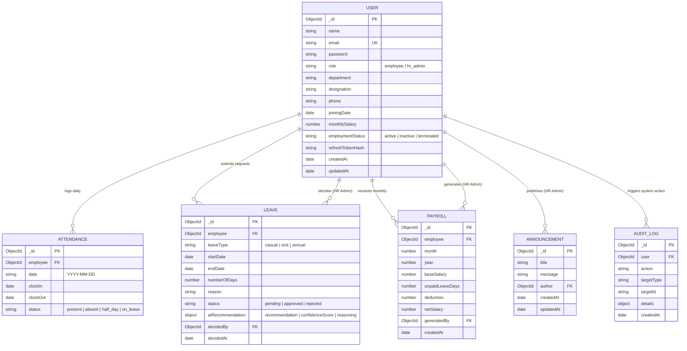

# FreshShifts HRMS — Enterprise Full-Stack MERN Platform

A production-grade, enterprise Human Resource Management System (HRMS) built with the MERN stack (MongoDB Atlas, Express.js, React 19, Node.js 20). Designed to streamline workforce operations for small-to-medium enterprises, featuring automated attendance tracking, AI-assisted leave evaluation (via Google Gemini 1.5 Pro), automated payroll processing with PDF generation, and executive company broadcasts.

---

## 📄 Product Documentation

- **Product Requirement Document (PDF):** [`doc/PRD_FreshShifts_HRMS.pdf`](doc/PRD_FreshShifts_HRMS.pdf)
- **Product Requirement Document (Markdown):** [`PRD_FreshShifts_HRMS.md`](PRD_FreshShifts_HRMS.md)

---

## 🔑 Demo Access Credentials

Use these pre-seeded accounts to evaluate the live deployment or local installation:

| Role | Email Address | Password | Permitted Portal & System Access |
|---|---|---|---|
| **HR Administrator** | `admin@freshshifts.com` | `Admin@123` | Full HR Admin Workspace (`/dashboard`, `/admin/*`) |
| **Employee** | `ali.hassan@freshshifts.com` | `Employee@123` | Employee Workspace (`/dashboard`, `/attendance`, `/leaves`, `/payroll`) |
| **Employee** | `sara.ahmed@freshshifts.com` | `Employee@123` | Employee Workspace |
| **Employee** | `usman.khan@freshshifts.com` | `Employee@123` | Employee Workspace |

---

## 📐 Entity Relationship Diagram (ERD)

The following relational model represents the core database schemas and relationships implemented in MongoDB via Mongoose ORM:



---

## 🛠️ Technology Stack & Architecture

| Layer | System Component / Library | Technical Description |
|---|---|---|
| **Frontend UI** | React 19 + Vite | SPA compiled architecture with zero-page-reload routing |
| **State Management** | Redux Toolkit | Centralized slice management (`auth`, `employees`, `attendance`, `leave`, `payroll`) |
| **Styling & Design** | Tailwind CSS v4 + DM Sans | Locked palette tokens (`Navy #0F172A`, `Teal #0284C7`), responsive layouts |
| **Animation Scope** | Framer Motion | Strict 5-moment bounded motion architecture for peak UI performance |
| **Backend API** | Node.js 20 + Express.js | Modular controller/service design with Vercel serverless integration |
| **Database** | MongoDB Atlas + Mongoose | Scalable cloud database with compound unique indices and schema validation |
| **Authentication** | Dual-Token JWT System | Short-lived Access Token (15m in Redux) + Long-lived Refresh Token (7d hashed in DB) |
| **AI Integration** | Google Gemini 1.5 Pro | Automated leave recommendation engine with 15s `Promise.race` timeout fallback |
| **PDF Generation** | PDFKit | Server-side binary PDF stream generation (`responseType: 'blob'`) |
| **Security & Logging** | Helmet, CORS, MongoSanitize, Winston | Hardened HTTP headers, NoSQL injection prevention, serverless-safe logging |

---

## ✨ Key Production-Grade Features

### 1. 🛡️ Silent Token Refresh (Axios HTTP Interceptor)
- Short-lived Access Tokens (15 mins) reside exclusively in Redux memory (never in `localStorage`).
- When an API request returns `401 Unauthorized`, the Axios interceptor queues pending requests, silently dispatches `POST /api/auth/refresh-token`, updates the token, and replays requests without user disruption.

### 2. 🤖 Contextual AI Leave Support & Privacy Rules
- Passes 30-day attendance trends, active leave balances, and team overlap metrics to Google Gemini AI.
- **Privacy Scoping Rule:** AI recommendation badges are **strictly restricted to HR Admin decision views** (`/admin/leaves`) and hidden from employee views.
- **Graceful Degradation:** Wrapped in a 15-second `Promise.race` timeout fallback to prevent serverless function hangs.

### 3. 💵 Payroll Engine & Joining-Date Validation Guard
- Deducts unpaid absence days based on daily rate formula ($\text{Net Salary} = \text{Base Salary} - (\text{Daily Rate} \times \text{Unpaid Absences})$).
- Rejects payroll generation for pay periods prior to an employee's `joiningDate` with a `400 Bad Request`.
- Enforces compound index `(employee, month, year)` to block duplicate payroll runs (`409 Conflict`).

### 4. ⏱️ Timezone-Aware Attendance Engine
- Normalizes all calendar operations to `APP_TIMEZONE` (`Asia/Karachi`) to prevent midnight UTC boundary bugs.
- Prevents duplicate clock-ins on the same calendar date.

---

## 📁 Repository Monorepo Structure

```
HRMS-FreshShift-MERN-Project-/
├── Client/                  # React + Vite Frontend Application
│   ├── src/
│   │   ├── app/             # Redux store configuration
│   │   ├── components/      # UI components (attendance, layout, shared, ui)
│   │   ├── pages/           # Screen views (auth, dashboard, employees, leaves, payroll)
│   │   ├── redux/           # Redux slices (auth, employee, attendance, leave, payroll)
│   │   └── lib/             # Axios instance & validators
│   ├── index.html
│   └── package.json
└── Server/                  # Node.js + Express Backend Service
    ├── config/              # DB connection, environment variables, timezone
    ├── controllers/         # Thin HTTP request handlers
    ├── middlewares/         # verifyToken, authorize, errorHandler, rateLimiter
    ├── models/              # Mongoose schemas (User, Attendance, Leave, Payroll, AuditLog)
    ├── routes/              # Express API endpoints
    ├── services/            # Core business & AI recommendation logic
    ├── seed.js              # Initial database seeder
    ├── vercel.json          # Vercel serverless deployment rewrite configuration
    └── package.json
```

---

## 🌐 API Endpoint Specification Matrix

| Method | Endpoint Path | Access Guard | Description |
|---|---|---|---|
| **GET** | `/api/health` | Public | System health check endpoint |
| **POST** | `/api/auth/login` | Public | Authenticate user & return tokens |
| **POST** | `/api/auth/refresh-token` | Public | Rotate refresh token for new access token |
| **POST** | `/api/auth/logout` | Authenticated | Revoke refresh token & invalidate session |
| **GET** | `/api/employees` | HR Admin | List all employees in roster |
| **POST** | `/api/auth/register` | HR Admin | Onboard new employee with generated credentials |
| **GET** | `/api/employees/me` | Authenticated | Retrieve self profile data |
| **PUT** | `/api/employees/:id` | HR Admin | Update employee record |
| **DELETE** | `/api/employees/:id` | HR Admin | Soft-delete (terminate) employee account |
| **POST** | `/api/attendance/clock-in` | Authenticated | Record daily clock-in |
| **POST** | `/api/attendance/clock-out` | Authenticated | Record daily clock-out |
| **GET** | `/api/attendance/me` | Authenticated | Retrieve self attendance history |
| **GET** | `/api/attendance` | HR Admin | Audit all workforce attendance logs |
| **POST** | `/api/leaves` | Authenticated | Submit leave application |
| **GET** | `/api/leaves/me` | Authenticated | Retrieve self leave history |
| **GET** | `/api/leaves` | HR Admin | Retrieve all pending/historical leave requests |
| **PUT** | `/api/leaves/:id/decision` | HR Admin | Approve/Reject leave with decision logging |
| **POST** | `/api/payroll/generate` | HR Admin | Compute absent deductions & generate payroll |
| **GET** | `/api/payroll/:employeeId` | Owner / HR Admin | Retrieve payroll history |
| **GET** | `/api/payroll/:id/download` | Owner / HR Admin | Stream PDF payslip blob |
| **GET** | `/api/announcements` | Authenticated | Fetch active company announcements |
| **POST** | `/api/announcements` | HR Admin | Publish new company broadcast |

---

## 🚀 Local Installation & Setup

### 1. Backend (`Server`) Setup
```bash
cd Server
npm install
cp .env.example .env
# Configure MONGO_URI, JWT_ACCESS_SECRET, JWT_REFRESH_SECRET, AI_API_KEY
npm run seed
npm start
```

### 2. Frontend (`Client`) Setup
```bash
cd Client
npm install
cp .env.example .env
# Set VITE_API_BASE_URL=http://localhost:5000/api
npm run dev
```

---

## 🧪 Testing & CI/CD Pipeline

- **Automated CI Pipeline:** Managed via GitHub Actions (`.github/workflows/ci.yml`). Runs Jest integration unit tests (`npm test`) on Node 20 environment upon push/PR to `main`.
- **Continuous Deployment (CD):** Managed via Vercel serverless integration triggering automatic zero-downtime builds upon passed CI checks.

---

## 📄 License
Developed for the FreshShifts HRMS capstone project. All rights reserved.
